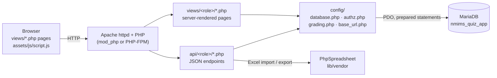

# NMIMS Quiz App 📚

A role-based online test platform built with PHP and MariaDB for NMIMS Hyderabad. Students take practice tests at their own pace; faculty build question banks, run tests and review results; admins manage users and the academic structure.

The app is built to run on a campus LAN behind Apache httpd, and needs no rewrite to move to a public web host.


---

## 📋 Contents

- [Features](#-features)
- [How it works](#-how-it-works)
- [Technology stack](#-technology-stack)
- [Project structure](#-project-structure)
- [Requirements](#-requirements)
- [Quick start (development)](#-quick-start-development)
- [Configuration](#-configuration) — every setting in one place
- [Deploying on Apache](#-deploying-on-apache)
- [Database](#-database) — schema, tables, backups
- [Accounts and passwords](#-accounts-and-passwords)
- [Using the app](#-using-the-app)
- [Grading rules](#-grading-rules)
- [Excel import formats](#-excel-import-formats)
- [API reference](#-api-reference)
- [Testing](#-testing) — local, CI, load testing
- [Code knowledge graph](#-code-knowledge-graph)
- [Security](#-security)
- [Troubleshooting](#-troubleshooting)
- [License](#-license)

---

## 🌟 Features

### Students
- See the tests assigned to them (by class, section, elective, re-exam group or by name) on their dashboard
- Wait in a lobby, then take the test with a countdown timer
- **MCQ** (one answer), **MSQ** (several answers) and **descriptive** questions
- Every answer is saved as they go; a lost connection can be resumed
- Instant results with a per-question breakdown (when the faculty allows it); export results to Excel

### Faculty
- Create tests: time limit, number of easy / medium / hard questions drawn per student, negative marking, calculator, instant results
- Add questions one by one or **bulk-upload from Excel**; edit and delete questions
- Run the test: **Open Lobby → Start Exam Now → End Exam Now**, with a live monitoring page (5-second refresh)
- Ending the test **automatically submits and grades every attempt a student did not submit**
- Mark descriptive answers, publish results, re-enable a locked student
- **Item analysis** per question; export results to Excel

### Admins
- User management: add users, bulk-import students from Excel, edit, delete, reset passwords
- Academic structure: **Schools → Courses → Batches (classes) → Sections**, plus **Electives** and **Re-exam groups**
- Demote students to a later graduation year
- Dashboard counts; database cleanup of graduated students and their old tests (preview first)

### Placement committee, school heads and other staff
- Read and export results of every test (school heads: only their own school)

---

## 🏗️ How it works



- **Pages** (`views/`) render HTML on the server and call the **JSON endpoints** (`api/`) with `fetch()`.
- Every page and endpoint loads `config/database.php`. Besides connecting to the database, it starts the session, enforces one active login per account, and blocks all other APIs until a forced password change is done.
- `config/authz.php` holds the shared permission checks: "is this quiz yours", "is this attempt yours", "is this student assigned to this quiz".
- `config/grading.php` holds the single grading routine, used when a student submits and when a faculty ends the test.
- `router.php` is only for PHP's built-in development server. Apache does not use it.

---

## 🛠️ Technology stack

| Layer | Technology |
|---|---|
| Language | PHP 8.1+ (developed and tested on 8.5) |
| Database | MariaDB 10.5+ (developed and tested on 11.8), InnoDB, utf8mb4 |
| Web server | Apache httpd 2.4 with mod_php or PHP-FPM (PHP's built-in server for development) |
| Frontend | Server-rendered PHP pages, vanilla JavaScript, one stylesheet, Chart.js |
| Excel | PhpSpreadsheet (Composer, installed into `lib/vendor`) |
| Auth | PHP sessions, role-based access control |
| Tests | Plain-PHP HTTP test suite (`tests/`), GitHub Actions CI, Locust load tests (`locust/`) |

---

## 📁 Project structure

```
nmims_quiz_app/
├── api/                      JSON / form endpoints, one folder per role
│   ├── auth.php              Login (single session, lockout, forced password change)
│   ├── admin/                Admin only (role 1): users, schools, courses, batches, sections,
│   │                         electives, re-exam groups, demotion, cleanup, password reset
│   ├── faculty/              Faculty only (role 2): quizzes, questions, status, monitoring,
│   │                         results, evaluation, item analysis, exports
│   ├── student/              Students only (role 4): start, save, submit, results, events
│   ├── placecom/             Any non-student role: results of all quizzes
│   └── shared/               Any logged-in user: dropdown data, quiz status,
│                             change password, results export (non-students)
├── assets/
│   ├── css/main.css          The one stylesheet
│   ├── js/script.js          Login, exam engine and shared helpers (loaded on every page)
│   ├── images/               Logo, favicon, background
│   └── templates/            header.php / footer.php and the two Excel import templates
├── config/
│   ├── database.php          DB connection, error handlers, session start, single-session and
│   │                         forced-password-change checks
│   ├── base_url.php          BASE_URL and URL helpers (get_asset_url, redirect, …)
│   ├── authz.php             Permission helpers, eligibility rule, DEFAULT_PASSWORD
│   └── grading.php           finalize_attempt(): disqualify or grade one attempt
├── views/                    Pages: admin/, faculty/, student/, placecom/, head/, shared/
├── lib/
│   ├── composer.json/.lock   PHP dependencies (PhpSpreadsheet)
│   ├── vendor/               Installed by Composer (not in git)
│   └── chartjs/chart.umd.js  Downloaded separately (not in git)
├── tests/                    Test suite: php tests/test.php
├── locust/                   Load tests (own README)
├── tools/graphify_augment.py Adds PHP structure edges to the knowledge graph
├── graphify-out/             Code knowledge graph (graph.json, GRAPH_REPORT.md)
├── .github/workflows/        CI: runs the test suite on every push and pull request
├── schema.sql                Full schema + seed data for a fresh install
├── index.php                 Sends a logged-in user to their role's dashboard
├── login.php / logout.php    Login page / logout
└── router.php                Router for PHP's built-in server only
```

---

## ✅ Requirements

| What | Version / notes |
|---|---|
| PHP | 8.1 or newer |
| PHP extensions | `pdo_mysql`, `mbstring`, `zip`, `gd`, `xml`, `dom`, `fileinfo`; `curl` for the test suite |
| MariaDB | 10.5 or newer (MySQL 8 should also work, but only MariaDB is tested) |
| Composer | 2.x, to install PhpSpreadsheet |
| Apache httpd | 2.4, for anything beyond development (see [Deploying on Apache](#-deploying-on-apache)) |

On Ubuntu / Debian:

```bash
sudo apt install php php-mysql php-mbstring php-zip php-gd php-xml php-curl composer mariadb-server
```

---

## 🚀 Quick start (development)

```bash
# 1. Get the code and its PHP dependencies
git clone https://github.com/aarushchaudhary/nmims_quiz_app.git
cd nmims_quiz_app
composer install --working-dir=lib

# 2. Chart.js (used on the student results page; not in git)
mkdir -p lib/chartjs
curl -o lib/chartjs/chart.umd.js https://cdn.jsdelivr.net/npm/chart.js@3/dist/chart.umd.js

# 3. Database and its user (choose your own password)
sudo mariadb -e "
  CREATE DATABASE nmims_quiz_app CHARACTER SET utf8mb4 COLLATE utf8mb4_general_ci;
  CREATE USER 'nmims_quiz_app'@'127.0.0.1' IDENTIFIED BY 'your-db-password';
  CREATE USER 'nmims_quiz_app'@'localhost' IDENTIFIED BY 'your-db-password';
  GRANT ALL PRIVILEGES ON nmims_quiz_app.* TO 'nmims_quiz_app'@'127.0.0.1';
  GRANT ALL PRIVILEGES ON nmims_quiz_app.* TO 'nmims_quiz_app'@'localhost';"
mariadb -h 127.0.0.1 -u nmims_quiz_app -p nmims_quiz_app < schema.sql

# 4. Run it
DB_PASS='your-db-password' php -S localhost:8080 router.php
```

Open <http://localhost:8080> and log in as **admin@nmims.in** with password **password**. You will be asked to choose a new password straight away.

`php -S` handles one request at a time, so it is fine for development but not for a class. For more than a handful of users, run Apache, or at least start the built-in server with workers: `PHP_CLI_SERVER_WORKERS=16 DB_PASS=… php -S 0.0.0.0:8080 router.php`.

---

## ⚙️ Configuration

### Environment variables

These are all the settings that change between machines. They are read with `getenv()`, so they work from a shell (`php -S`), from Apache's `SetEnv` (mod_php and PHP-FPM), and from GitHub Actions.

| Variable | Default | Used in | What it does |
|---|---|---|---|
| `DB_PASS` | *(none, required)* | `config/database.php`, `tests/bootstrap.php` | Database password. Not stored in the repo. If unset, every page shows "Database connection failed". |
| `DB_HOST` | `127.0.0.1` | same | Database server host. |
| `DB_PORT` | `3306` | same | Database server port. |
| `DB_NAME` | `nmims_quiz_app` | same | Database name. `schema.sql` creates this name, so if you change it, edit the first lines of `schema.sql` too. |
| `DB_USER` | `nmims_quiz_app` | same | Database user. |
| `BASE_URL` | `/` | `config/base_url.php` | URL path the app is served under, used for every link, asset and redirect. `/` at the root of a domain or virtual host; `/quiz/` when served from a sub-folder. A trailing slash is added if missing. |

### Settings in the code

Change these by editing the file. Each one is a named constant or a clearly commented value.

| Setting | Value | Where | What it does |
|---|---|---|---|
| Default password | `password` | `DEFAULT_PASSWORD` in `config/authz.php` | Starting password of every account an admin creates. |
| Login lockout | 5 wrong passwords → 15 minutes | `MAX_FAILED_LOGINS`, `LOCKOUT_MINUTES` in `api/auth.php` | Locks an account after repeated wrong passwords. An admin password reset unlocks it. |
| Minimum password length | 6 | `api/shared/change_password.php` | Applies when a user changes their password. |
| Violation limit | 3 | `VIOLATION_LIMIT` in `config/grading.php` **and** the `>= 3` check in `assets/js/script.js` | Tab switches, leaving fullscreen or blocked keys before the attempt is disqualified. Change both places together. |
| Answer save grace period | 30 seconds | `api/student/save_answer.php` | How long after an attempt's deadline a save is still accepted (network delay). |
| Status polling | exam 10 s, lobby 5 s, faculty monitor 5 s | `assets/js/script.js`, `views/student/lobby.php`, `views/faculty/start_quiz.php` | How often pages check for changes. Lower values mean more requests per student. |
| Student SAP ID format | 11 digits: course code (4) + start year (2) + end year (2) + roll no. (3) | `api/admin/add_user.php`, `api/admin/upload_students.php` | Used to derive course and batch automatically. |
| Student email domain | must end in `nmims.in` | same | Checked on add and upload. |

### PHP settings (`php.ini`)

| Setting | Recommended | Why |
|---|---|---|
| `date.timezone` | your campus time zone, e.g. `Asia/Kolkata` | PHP computes each attempt's deadline. It **must match MariaDB's time zone** (below), or tests open, close or expire at the wrong time. |
| `upload_max_filesize` / `post_max_size` | `10M` / `12M` | Excel uploads of questions and students. The PHP default of 2 MB fits a few thousand rows. |
| `max_execution_time` | `60` | "End Exam Now" grades every unsubmitted attempt in one request (a few seconds for 500 students). |
| `session.gc_maxlifetime` | `7200` (2 hours) | Idle time before a login expires. The default is 24 minutes, which can log out a faculty member who leaves the monitoring page open. Students on the exam page stay logged in because the page polls. |
| `display_errors` | `Off` | Already forced off by `config/database.php`; errors go to the PHP error log. |

### MariaDB settings

| Setting | Recommended | Why |
|---|---|---|
| `time_zone` | same zone as PHP, e.g. `default-time-zone = '+05:30'` in `[mysqld]` | Quiz start/end windows are compared with the database's `NOW()`. |
| `max_connections` | more than your PHP worker count (default 151 is enough for 50–100 workers) | Each PHP request opens one connection. |
| `sql_mode` | default (includes `STRICT_TRANS_TABLES`) | The app is tested in strict mode. |

---

## 🌐 Deploying on Apache

Below is a full Ubuntu setup with **PHP-FPM**, the recommended way. A `mod_php` variant follows. Both serve the app from `/var/www/nmims_quiz_app`.

### 1. Code, dependencies, database

Do steps 1–3 of the [Quick start](#-quick-start-development) inside `/var/www/nmims_quiz_app`, then:

```bash
sudo chown -R root:www-data /var/www/nmims_quiz_app
sudo chmod -R u=rwX,g=rX,o= /var/www/nmims_quiz_app
```

The app never writes to its own folder. Sessions go to PHP's session directory and uploads are read from PHP's temp directory, so read-only access is enough.

### 2. Apache + PHP-FPM

```bash
sudo apt install apache2 php-fpm
sudo a2enmod proxy_fcgi setenvif
sudo a2enconf php8.5-fpm          # match your PHP version: ls /etc/apache2/conf-available | grep fpm
```

Create `/etc/apache2/sites-available/nmims-quiz.conf`:

```apache
<VirtualHost *:80>
    ServerName quiz.nmims.local
    DocumentRoot /var/www/nmims_quiz_app
    DirectoryIndex index.php

    # --- App configuration (see Configuration) ---
    SetEnv DB_PASS  "your-db-password"
    SetEnv BASE_URL "/"
    # SetEnv DB_HOST "127.0.0.1"   DB_PORT / DB_NAME / DB_USER likewise

    <Directory /var/www/nmims_quiz_app>
        Require all granted
        AllowOverride None
        Options -Indexes
        # Unknown URLs go to the app's entry point (what router.php does for php -S).
        FallbackResource /index.php
    </Directory>

    # --- Never serve these over the web ---
    # tests/ and locust/ can run against the database; .git holds the full history.
    <DirectoryMatch "^/var/www/nmims_quiz_app/(\.git|\.github|tests|locust|tools|graphify-out|lib/vendor)(/|$)">
        Require all denied
    </DirectoryMatch>
    <FilesMatch "(\.(sql|md|json|lock|sh|py|txt|yml)|^router\.php|^\.env.*|^\.gitignore)$">
        Require all denied
    </FilesMatch>

    ErrorLog  ${APACHE_LOG_DIR}/nmims-quiz-error.log
    CustomLog ${APACHE_LOG_DIR}/nmims-quiz-access.log combined
</VirtualHost>
```

```bash
sudo a2ensite nmims-quiz && sudo a2dissite 000-default
sudo apachectl configtest && sudo systemctl reload apache2
```

PHP-FPM receives the `SetEnv` values as FastCGI parameters, and `getenv()` reads them. Nothing else is needed.

### 3. Sizing for a full class

The app was load-tested with **500 students taking one 30-question test at the same moment** (start, 15,000 answer saves, submit) on 32 PHP workers, with zero errors:

| Step (all 500 at once) | Total time | Slowest request |
|---|---|---|
| Log in | 7.4 s | 7.3 s (password hashing is deliberately slow) |
| Start test | 0.7 s | 0.65 s |
| One round of answer saves | 0.1–0.2 s | ~0.1 s |
| Submit | 0.8 s | 0.73 s |

Requests are short, so a few dozen PHP workers serve hundreds of students. In `/etc/php/8.5/fpm/pool.d/www.conf`:

```ini
pm = dynamic
pm.max_children = 50       ; keep below MariaDB max_connections
pm.start_servers = 10
pm.min_spare_servers = 5
pm.max_spare_servers = 20
```

Keep Apache on the default **event** MPM with PHP-FPM; its default limit of 150 simultaneous connections is enough because most requests finish in under a second. The database (2,000 students, 500 at once) is not the bottleneck.

### Alternative: mod_php

```bash
sudo apt install apache2 libapache2-mod-php
sudo a2dismod mpm_event && sudo a2enmod mpm_prefork php8.5
```

Use the same `<VirtualHost>` block. `SetEnv` values reach `getenv()` with mod_php as well. Each prefork process holds a full PHP interpreter (about 30–60 MB), so set `MaxRequestWorkers` in `/etc/apache2/mods-enabled/mpm_prefork.conf` to what your RAM allows (e.g. 100 workers ≈ 4–6 GB).

### Serving from a sub-folder

To serve the app at `http://server/quiz/` instead of a whole virtual host:

```apache
Alias /quiz /var/www/nmims_quiz_app
<Directory /var/www/nmims_quiz_app>
    Require all granted
    FallbackResource /quiz/index.php
</Directory>
SetEnv BASE_URL "/quiz/"
```

Copy the `DirectoryMatch` / `FilesMatch` deny rules too.

### HTTPS

On a LAN, plain HTTP works. If the app is ever put on the public internet, add TLS (e.g. `certbot --apache`), and the session cookie should then also be marked `Secure`. Today it is `HttpOnly` and `SameSite=Lax`.

---

## 🗄️ Database

### Fresh install

`schema.sql` creates the database, all tables, the lookup data (roles, question types, difficulties, quiz statuses) and the first admin account (`admin@nmims.in` / `password`, forced to change at first login).

```bash
mariadb -h 127.0.0.1 -u nmims_quiz_app -p nmims_quiz_app < schema.sql
```

`schema.sql` is the single source of truth for the database structure. There are no separate migration files.

### Tables

| Table | Holds |
|---|---|
| `roles` | admin (1), faculty (2), placecom (3), student (4), school head (5), director (6), plus any added by admins |
| `users` | Every account: email, password hash, role, active session, forced-change flag, lockout counters |
| `admins`, `faculties`, `students`, `placecom_officers`, `heads` | Per-role profile (name, SAP ID, school, course, batch, graduation year) |
| `schools` → `courses` → `classes` → `batches` | Academic structure. A **class** is a cohort (course + graduation year + SAP ID range); a **batch** is a section of a class with its own SAP ID range |
| `electives`, `elective_students` | Elective subjects and who takes them |
| `re_exam_groups`, `re_exam_group_students` | Re-exam groups (with expiry) and their students |
| `specializations`, `student_specializations` | Specialisations per course and student |
| `quizzes` | Test settings, owner faculty, time window, status, question counts per difficulty, marking options |
| `quiz_classes`, `quiz_batches`, `quiz_electives`, `quiz_re_exam_groups`, `quiz_manual_students` | Who a test is assigned to |
| `questions`, `options` | Question bank and answer options (with the correct ones marked) |
| `quiz_lobby` | Students waiting in a test's lobby |
| `student_attempts` | One row per student per test: the question set they got, deadline, score, submitted / disqualified flags |
| `student_answers` | One row per question per attempt: chosen options or text, correctness, marks |
| `event_logs` | Tab switches and other events recorded during an attempt |
| `question_types`, `question_difficulties`, `exam_statuses` | Lookup lists |

Quiz statuses: **1 Not Started**, **2 Lobby Open**, **3 In Progress**, **4 Completed**, **5 Cancelled**.

### Backups

```bash
mariadb-dump -h 127.0.0.1 -u nmims_quiz_app -p --single-transaction nmims_quiz_app > backup_$(date +%F).sql
# restore:  mariadb -h 127.0.0.1 -u nmims_quiz_app -p nmims_quiz_app < backup_YYYY-MM-DD.sql
```

---

## 🔑 Accounts and passwords

| Rule | Details |
|---|---|
| Default password | Every account created by an admin (form or Excel upload) starts with the password **`password`**. |
| Forced change | Such accounts must change the password at first login. Until they do, every page redirects to *Change Password* and every API answers `403`. The new password can't be `password`, a student's SAP ID, or shorter than 6 characters. |
| Admin reset | An admin can set a new password for any user (Reset Password, or a new password on Edit User). The user must change it at their next login, and the reset also lifts a lockout. |
| Lockout | 5 wrong passwords in a row lock the account for 15 minutes (`429 Too many failed login attempts`). A correct login resets the counter. |
| One login at a time | Logging in on a second device ends the first session; the login page warns first. Logout frees the account. |
| Role routing | After login, `index.php` sends admins, faculty, placecom, students and school heads to their dashboards; any other role (e.g. director) to the shared dashboard. |

---

## 📖 Using the app

### Faculty: running a test
1. **Manage Quizzes → Create Quiz.** Set the title, time window, duration, how many easy / medium / hard questions each student gets, marking options, and who it is for (classes, sections, electives, re-exam groups or individual students).
2. **Add questions.** Use the form, or **Upload Questions** with the Excel template. The bank needs at least as many questions per difficulty as each student draws.
3. **Start Quiz page:**
   - **Open Lobby** (status 2): students can join and wait.
   - **Start Exam Now** (status 3): each student gets their own random question set and timer.
   - **End Exam Now** (status 4): students still in the test are submitted automatically, and attempts that were never submitted (closed laptop, lost Wi-Fi) are graded too.
4. **Evaluate** descriptive answers (0 up to the question's marks), then **Publish Results** if instant results were off.
5. **Reports:** results table, **Item Analysis**, **Export to Excel**.

### Students
1. Dashboard → open a test → wait in the lobby.
2. When the faculty starts it, the test opens in fullscreen. Answers save on **Save & Next** and on submit, and the timer is enforced by the server.
3. Submit (or the timer ends it), then view results if published.

### Admins
- **User Management:** add, edit, delete, reset passwords; **Upload Students** from Excel.
- **Schools / Courses / Batches / Sections / Electives / Re-exam groups:** build the structure tests are assigned to.
- **Demote Students:** move a student, or a whole cohort, to a later graduation year.
- **Cleanup:** preview, then delete students who graduated on or before a chosen year, along with every test assigned to those cohorts' classes or sections (and those tests' attempts). Take a [backup](#backups) first.

### Placecom, school heads, directors
- **Reports:** filter tests, pick one, view or export its results. School heads only see their own school's tests.

---

## 🧮 Grading rules

All grading happens on the server in `config/grading.php`.

| Question | Result | Marks |
|---|---|---|
| MCQ | correct option | full marks |
| MCQ | wrong option | 0, or minus the MCQ negative mark if negative marking is on |
| MSQ | exactly the correct options | full marks |
| MSQ | some correct options, **no wrong ones** | marks × (correct picked ÷ total correct) |
| MSQ | any wrong option picked | 0, or minus the MSQ negative mark |
| Any | unanswered | 0 |
| Descriptive | marked by faculty | 0 to the question's marks |

An attempt with **3 or more recorded violations** is disqualified instead of graded. Faculty can re-enable it from the monitoring page.

---

## 📄 Excel import formats

Both templates are in `assets/templates/`. Row 1 is the header; data starts at row 2.

**Students** (`student_template.xlsx`, Admin → Upload Students):

| A | B | C |
|---|---|---|
| Full name | Email (must end in `nmims.in`) | 11-digit SAP ID |

The course and batch come from the SAP ID; the course code (first 4 digits) must already exist. Rows with a duplicate email or SAP ID are skipped and listed after the upload.

**Questions** (`question_template.xlsx`, Faculty → View Quiz → Upload):

| A | B | C | D | E–H | I |
|---|---|---|---|---|---|
| Question text | Type: 1 MCQ, 2 MSQ, 3 Descriptive | Difficulty: 1 easy, 2 medium, 3 hard | Marks | Options 1–4 | Correct option number(s), comma-separated, e.g. `2` or `1,3` |

---

## 🔌 API reference

Every endpoint is a PHP file under `api/`; the session cookie authenticates. JSON endpoints answer `403` when not logged in, when the role is wrong, or when the record isn't yours (all three look the same on purpose). The "change your password first" rule returns `403` for every API except `auth.php` and `shared/change_password.php`.

### Authentication

| Method | Endpoint | Body | Notes |
|---|---|---|---|
| POST | `api/auth.php` | JSON `{email, password, force?}` | `{status: success \| conflict \| error}`. `conflict` = logged in elsewhere; resend with `force: true`. `401` wrong credentials, `429` locked. |
| GET | `logout.php` | — | Ends the session and frees the account. |

### Admin (role 1)

| Method | Endpoint | Parameters |
|---|---|---|
| GET | `api/admin/get_dashboard_stats.php` | — |
| POST | `api/admin/add_user.php` | form: `email, full_name, role_id`, plus `sap_id` (students) or `staff_sap_id, staff_school_id, is_visiting` (staff). Password is always the default. |
| POST | `api/admin/update_user.php` | form: user fields, optional `password` (forces a change at next login) |
| POST | `api/admin/delete_user.php` | JSON `{user_id}` |
| POST | `api/admin/reset_password.php` | JSON `{user_id, new_password}`; forces a change at next login, clears lockout |
| POST | `api/admin/upload_students.php` | multipart `student_file` (.xlsx) |
| POST | `api/admin/add_school.php` · `add_course.php` · `add_role.php` | form fields of the item |
| POST | `api/admin/add_batch.php` | `school_id, course_id, graduation_year` (creates a class) |
| POST | `api/admin/add_class.php` · `edit_class.php` | sections with SAP ID ranges |
| POST | `api/admin/add_elective.php` · `add_elective_students.php` | elective name / `sap_ids` |
| POST | `api/admin/add_re_exam_group.php` · `add_re_exam_students.php` | group name, expiry / `sap_ids` |
| POST | `api/admin/delete_school.php` · `delete_course.php` · `delete_role.php` · `delete_batch.php` · `delete_class.php` · `delete_elective.php` · `delete_re_exam_group.php` | form: `id` (**POST only**) |
| POST | `api/admin/remove_elective_student.php` | form: `elective_id, student_id` |
| POST | `api/admin/remove_re_exam_student.php` | form: `group_id, student_id` |
| POST | `api/admin/demote_students.php` · `demote_single_student.php` | cohort / student and target year |
| GET | `api/admin/search_student.php` | `?q=` |
| GET | `api/admin/get_students_for_demotion.php` · `get_course_batches.php` | filters |
| GET / POST | `api/admin/cleanup_preview.php` / `execute_cleanup.php` | retention year |

### Faculty (role 2, own quizzes only)

| Method | Endpoint | Parameters |
|---|---|---|
| POST | `api/faculty/create_quiz.php` · `update_quiz.php` | form: quiz settings and assignment |
| POST | `api/faculty/delete_quiz.php` | JSON `{quiz_id}` |
| POST | `api/faculty/update_quiz_status.php` | JSON `{quiz_id, new_status_id}`; status 4 also auto-submits open attempts (`auto_submitted` in the response) |
| POST | `api/faculty/add_manual_question.php` · `update_question.php` | form: question, type, difficulty, points, options, correct answers |
| POST | `api/faculty/delete_question.php` | JSON `{question_id}` |
| POST | `api/faculty/upload_questions.php` | multipart `question_file` (.xlsx), `quiz_id` |
| GET | `api/faculty/get_lobby_students.php` | `?id=<quiz_id>` |
| GET | `api/faculty/get_live_monitoring_data.php` | `?id=<quiz_id>&page=&limit=` |
| POST | `api/faculty/reenable_student.php` | JSON `{attempt_id}` |
| POST | `api/faculty/save_evaluation.php` | JSON `{answer_id, score}`; score 0 … question marks |
| POST | `api/faculty/publish_results.php` | JSON `{quiz_id, …}` |
| GET | `api/faculty/get_quiz_results.php` · `get_item_analysis.php` | `?quiz_id=` |
| GET | `api/faculty/export_results.php` | `?quiz_id=` → .xlsx |

### Student (role 4, own attempts only)

| Method | Endpoint | Parameters |
|---|---|---|
| GET | `api/student/fetch_exam_questions.php` | `?id=<quiz_id>`; only for assigned quizzes that are In Progress; creates or resumes the attempt |
| POST | `api/student/save_answer.php` | JSON `{attempt_id, question_id, selected_option_ids[], answer_text?, time_spent}`; refused after the deadline |
| POST | `api/student/finish_exam.php` | JSON `{attempt_id}` |
| POST | `api/student/log_event.php` | JSON `{attempt_id, event_type, description}` |
| GET | `api/student/get_attempt_status.php` | `?id=<attempt_id>` |
| GET | `api/student/get_detailed_results.php` | `?attempt_id=` (only when results are published) |
| GET | `api/student/export_student_results.php` | `?attempt_id=` → .xlsx |

### Shared

| Method | Endpoint | Who | Parameters |
|---|---|---|---|
| GET | `api/shared/get_quiz_status.php` | anyone | `?id=<quiz_id>` |
| GET | `api/shared/get_courses_by_school.php` · `get_batches_by_course.php` · `get_years_by_course.php` · `get_groups_by_courses.php` | anyone | dropdown filters |
| POST | `api/shared/change_password.php` | logged in | JSON `{current_password, new_password, confirm_password}`; `current_password` not needed during a forced change |
| GET | `api/shared/export_all_results.php` | non-students (heads: own school) | `?quiz_id=` → .xlsx |
| GET | `api/placecom/get_all_quiz_results.php` | non-students (heads: own school) | `?quiz_id=` |

---

## 🧪 Testing

### Test suite

`tests/` holds a dependency-free PHP suite that sends real HTTP requests to a running server and checks status codes, JSON and database state. It covers authentication, admin CRUD, the faculty test lifecycle, the full student flow, grading (MCQ / MSQ partial / negative marking), auto-submit on test end, and regression tests for every permission and security fix.

```bash
DB_PASS='your-db-password' php -S localhost:8080 router.php &     # server under test
DB_PASS='your-db-password' php tests/test.php                     # all suites
DB_PASS='your-db-password' php tests/test.php --filter=Student    # suites whose name contains "Student"
DB_PASS='your-db-password' php tests/test.php --verbose           # print requests and responses
DB_PASS='your-db-password' php tests/test.php --base-url=http://localhost:9000
```

The suite creates its own fixtures (users `test_*@nmims.in`, quizzes titled `TEST_QUIZ`, names starting `PHPUNIT_`) in the database the variables point to, and removes them afterwards. Leftovers from an interrupted run are removed at the next start. It never touches other data, but **run it against a development database**, not the live one. It exits with code 1 if any test fails.

### Continuous integration

`.github/workflows/release.yml` runs the suite on every push and pull request. It starts MariaDB 11.8 and PHP 8.5, installs dependencies, loads `schema.sql`, starts the app with `php -S` and runs `php tests/test.php`. On failure it prints the server log. The CI database password is a throwaway value inside the workflow.

### Load testing

`locust/` contains Locust scenarios for every role; see [`locust/README.md`](locust/README.md). Because each account allows only one active login, **each simulated user needs its own account**. Pointing 50 simulated students at one account makes them log each other out.

---

## 🧠 Code knowledge graph

`graphify-out/` holds a [graphify](https://pypi.org/project/graphifyy/) knowledge graph of the code: files, functions, which pages call which APIs, which files read or write which tables, foreign keys and role checks. Only `graph.json`, `GRAPH_REPORT.md` and the community labels are committed; caches, `graph.html` and machine-specific files are git-ignored.

```bash
graphify query "how does a student submit an exam"        # ask the graph
graphify path "exam.php" "student_answers (table)"        # how two things connect
graphify explain "finalize_attempt()"                     # a node and its neighbours
graphify export html                                      # rebuild graph.html to browse locally
```

To update it after code changes: graphify's PHP parser can't see the links inside procedural scripts, so `tools/graphify_augment.py` adds them.

```bash
graphify update . && python3 tools/graphify_augment.py . && graphify cluster-only . --no-label
```

---

## 🔐 Security

| Area | How |
|---|---|
| SQL injection | Every query uses PDO prepared statements, with native (non-emulated) prepares |
| Passwords | bcrypt via `password_hash()`; default password and forced change; 5-try lockout |
| Sessions | One active session per account; ID regenerated at login and password change; cookie `HttpOnly` and `SameSite=Lax` |
| CSRF | `SameSite=Lax` cookie, and state-changing admin actions accept POST only |
| Access control | Every endpoint checks the role; faculty only reach their own quizzes, students only their own attempts and assigned quizzes, school heads only their school's results |
| Output | Page output escaped with `htmlspecialchars()`; question, option and answer text set as text, not HTML |
| Exam integrity | Server-side deadline, server-side grading, attempt row locked on submit, one answer row per question |
| Errors | `display_errors` off; details go to the PHP error log only |
| Files | Apache config blocks `.git`, `tests/`, `locust/`, `tools/`, `lib/vendor` and config/data files |

Known limits: any non-student role (including every faculty member) can read every quiz's results through the reports page. That is intended for placecom and heads; restrict `api/placecom/` and `api/shared/export_all_results.php` if faculty shouldn't. Browser-side checks such as tab switching can be bypassed by a determined student; the app is meant for self-paced practice, not high-stakes exams.

---

## 🛠️ Troubleshooting

| Symptom | Cause / fix |
|---|---|
| "Database connection failed" on every page | `DB_PASS` (or another `DB_*`) isn't reaching PHP. With Apache, check `SetEnv` in the virtual host and reload Apache; with `php -S`, set the variable on the same command line. |
| Links and CSS broken, URLs missing a folder | `BASE_URL` doesn't match where the app is served. Use `/` for a virtual host and `/folder/` for a sub-folder. |
| "Too many failed login attempts" | Wait 15 minutes, or have an admin reset the password. |
| Every action says "Please change your password before continuing" | The account still has the default or a reset password. Open *Change Password*. |
| "This account is already logged in elsewhere" | Another session is active. Continuing logs the other one out. |
| Student: "This exam is not in progress" | The faculty hasn't pressed *Start Exam Now*, or has already ended it. |
| Student can't see a test | They aren't assigned: check the quiz's classes / sections / electives / re-exam groups and the student's SAP ID range and graduation year. |
| Tests open or close at the wrong time | PHP `date.timezone` and MariaDB `time_zone` differ. Set both to the campus time zone. |
| Excel upload fails | File larger than `upload_max_filesize` / `post_max_size`, or a missing PHP extension (`zip`, `xml`, `gd`). |
| Faculty logged out while monitoring | Raise `session.gc_maxlifetime`. |
| Results page has no chart | `lib/chartjs/chart.umd.js` wasn't downloaded (Quick start step 2). |

---

## 📝 License

GNU General Public License v3.0. See [LICENSE](LICENSE).

## 👨‍💻 Author

**Aarush Chaudhary** — STME, NMIMS Hyderabad

## 🙏 Acknowledgments

- [PhpSpreadsheet](https://github.com/PHPOffice/PhpSpreadsheet): Excel import and export
- [Chart.js](https://www.chartjs.org/): result charts
